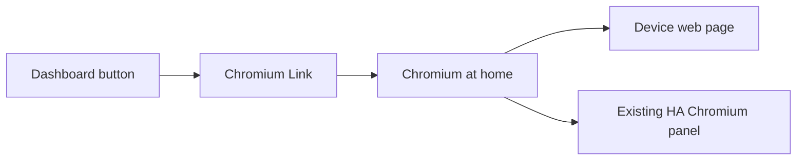

<div align="center">
  
  <h1>Chromium Link</h1>
  <p><strong>Open the web pages on your home network from the Home Assistant dashboard you already use.</strong></p>
  <p>
    <a href="https://my.home-assistant.io/redirect/marketplace_repository/?owner=thomasgregg&amp;repository=chromium-link&amp;category=integration"></a>
  </p>
  <p><a href="#install">Install</a> · <a href="#add-your-first-button">Add a button</a> · <a href="#troubleshooting">Troubleshooting</a></p>
</div>

Imagine checking an ESPHome sensor on your Home Assistant dashboard while away from home. You spot something to investigate, so you tap **Open sensor web UI**. Chromium running at home opens the sensor’s page, and Home Assistant brings that browser into view.

Use it for **ESPHome web pages**, **WLED controllers**, **router settings**, **NAS consoles**, and **printer interfaces**. Anything with an HTTP or HTTPS page that Chromium can reach from your home network is a candidate. Each standard dashboard button carries its own device address.

> **Early preview.** The launcher and its URL handling have been exercised against local Chromium. A full Home Assistant OS and Nabu Casa smoke test is on the [release checklist](docs/marketplace.md#before-publishing). Install it from the Marketplace as a custom repository or try the manual installation below.

## What you need

- Home Assistant OS with **Home Assistant 2026.11 or later** and an administrator account.
- The [Mincka Chromium app](https://github.com/Mincka/ha-addons/tree/main/chromium), version **1.7.0 or later**, installed and running. To add it, open **Settings → Apps → Install app → ⋮ → Repositories** and add `https://github.com/mincka/ha-addons`, then install **Chromium**.
- A way to reach your Home Assistant dashboard remotely, such as Home Assistant Cloud by Nabu Casa, if you want to use the links away from home.

## Install

### 1. Enable Chromium’s internal control connection

Open **Settings → Apps → Chromium → Configuration**. Set `CHROMIUM_REMOTE_DEBUGGING` to `"1"` and save. In **Network**, leave the `9222/tcp` host port blank. Restart Chromium. In its **Info** tab, enable **Show in sidebar** and **Start on boot**.

Before continuing, open **Chromium** from the sidebar and enter one of your device URLs in its address bar. This confirms the browser at home can reach it.

### 2. Add the integration

Use the Marketplace button above, or open **Settings → Marketplace → Add from link**. Paste `https://github.com/thomasgregg/chromium-link` and select **Add**. Connect GitHub if prompted. Then open **Chromium Link** in the Marketplace and select **Install**.

Follow the setup prompt, or open **Settings → Devices & services → Add integration → Chromium Link**. The setup has no fields. Follow any restart prompt shown by Home Assistant.

<details>
<summary>Manual installation</summary>

1. Download a tagged [release](https://github.com/thomasgregg/chromium-link/releases), or use **Code → Download ZIP** to try the current preview.
2. Copy the `custom_components/chromium_link` folder into the `custom_components` folder beside your Home Assistant `configuration.yaml`.
3. Restart Home Assistant. Open **Settings → Devices & services → Add integration → Chromium Link**.

</details>

## Add your first button

Edit an existing dashboard and add a **Button** card. Name it after your device. In its tap action, choose **Navigate** and paste the navigation path below, replacing `http://esp-sensor.local/` with the address you normally type into Chromium.

```text
/chromium-launch?url=http://esp-sensor.local/
```

<details>
<summary>Copy the complete Button card YAML</summary>

```yaml
type: button
name: Open ESPHome sensor via HA
icon: mdi:open-in-new
tap_action:
  action: navigate
  navigation_path: "/chromium-launch?url=http://esp-sensor.local/"
```

</details>

For more devices, duplicate the button and change its name and address. Paste the full device address after `/chromium-launch?url=` exactly as you copied it from the browser, including any page options or `#` section.

```text
/chromium-launch?url=http://device.local/settings?tab=wifi&mode=advanced#status
```

## Use it away from home

Open your usual HA dashboard and tap the button. Chromium opens the device in a new tab, then Home Assistant shows the existing Chromium panel. **Back** returns you to your dashboard.

| Button | What opens | When to use it |
| --- | --- | --- |
| **Open via HA** | Chromium running on your Home Assistant host | At home or away through your HA remote connection |
| **Open directly** | The browser you’re using right now | On your home network or a VPN that can reach the device |

To add the second option, use another standard Button card with the **Open URL** tap action and paste the plain device address.

## How it works



The integration sends a tab-opening command to Chromium over Home Assistant’s internal network. Chromium connects to the device from home, and HA’s existing Ingress connection displays the browser. Device addresses live in dashboard buttons. Chromium uses its usual shared browser session for its tabs, history, and sign-ins.

## Troubleshooting

| What you see | What to check |
| --- | --- |
| **Chromium Link isn’t in Add integration** | Check that the downloaded folder is `custom_components/chromium_link`. Restart HA if you installed it manually. |
| **Home Assistant could not find the Mincka Chromium app** | Confirm that Chromium was installed from `https://github.com/mincka/ha-addons` using that repository URL. Other Chromium apps use different Supervisor IDs. |
| **Start Chromium** | Start the app and wait for its existing sidebar panel to load. |
| **Chromium did not confirm** | Check that `CHROMIUM_REMOTE_DEBUGGING` is `"1"`, Chromium was restarted, and its internal DevTools connection is reachable. Keep the host port mapping blank. |
| **The Chromium tab opens, but the device page fails** | Try the same address inside Chromium. Check the hostname or IP, port, and whether the device actually serves a web page. |
| **Open Chromium Link from a Home Assistant dashboard button** | Use your dashboard button to launch the page. A pasted launcher link in your browser’s address bar displays this message. |

## Security and support

Launching is restricted to Home Assistant administrators. Chromium’s DevTools connection can control the whole browser session. The add-on makes it reachable to other apps on HA’s internal network, even when the host port is unpublished. Use a trusted add-on environment and keep the host port unmapped. Keep credentials out of device URLs.

For problems, [open a GitHub issue](https://github.com/thomasgregg/chromium-link/issues/new/choose) with your Home Assistant and Chromium versions and the error shown. [Report security issues privately](SECURITY.md). See the [changelog](CHANGELOG.md), [contribution guide](CONTRIBUTING.md), and [Marketplace release checklist](docs/marketplace.md).

Chromium Link is an independent community integration released under the [MIT License](LICENSE).
