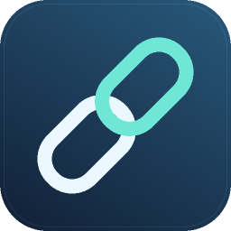
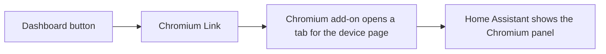

<div align="center">
  
  <h1>Chromium Link</h1>
  <p><strong>Open local device web pages from your Home Assistant dashboard while you’re away.</strong></p>
  <p>
    <a href="#what-you-need"></a>
    <a href="https://github.com/thomasgregg/chromium-link/actions/workflows/validate.yml"></a>
    <a href="LICENSE"></a>
  </p>
</div>

You can reach your Home Assistant dashboard remotely. When you tap a regular dashboard link to `http://wled.local/`, your phone or laptop tries to connect directly to the device. The page won’t load if your phone or laptop can’t reach your local network.

Chromium Link opens the device page in [Chromium](https://github.com/Mincka/ha-addons/tree/main/chromium) running on your Home Assistant host and shows it through the remote connection you already use. Each shortcut is a standard dashboard button with the device’s usual URL. You can skip the VPN client and keep device web interfaces on your local network.

## Contents

- [What you need](#what-you-need)
- [Installation](#installation)
  - [Configure the Chromium add-on](#1-configure-the-chromium-add-on)
  - [Install Chromium Link](#2-install-chromium-link)
- [Add your first button](#add-your-first-button)
- [How it works](#how-it-works)
- [Troubleshooting](#troubleshooting)
- [Chromium Link vs. other options](#chromium-link-vs-other-options)
- [Security and support](#security-and-support)

## What you need

- Home Assistant OS with **Home Assistant 2026.11 or later** and an administrator account.
- **Mincka Chromium 1.7.0 or later**, installed and running on your Home Assistant host. To add it, open **Settings → Apps → Install app → ⋮ → Repositories** and add `https://github.com/mincka/ha-addons`, then install **Chromium**. [Mincka Chromium add-on](https://github.com/Mincka/ha-addons/tree/main/chromium)
- For use away from home, remote access to your Home Assistant dashboard, such as **Home Assistant Link** from Nabu Casa. The setting is called **Home Assistant Cloud** through Home Assistant 2026.11. [Home Assistant remote access guide](https://www.home-assistant.io/docs/configuration/remote/)

<a name="install"></a>

## Installation

### 1. Configure the Chromium add-on

Open **Settings → Apps → Chromium → Configuration**. Set `CHROMIUM_REMOTE_DEBUGGING` to `"1"` and save. In **Network**, leave the `9222/tcp` host port blank. Restart Chromium. In its **Info** tab, enable **Show in sidebar** and **Start on boot**.

Before continuing, open **Chromium** from the sidebar and enter a device address, such as `http://wled.local/`. This confirms that the add-on can reach your device.

### 2. Install Chromium Link

<!-- ha-marketplace:exclude-start -->

Search for **Chromium Link** in the default catalog and open the result:

- **Home Assistant Marketplace:** Open **Settings → Marketplace**, search for **Chromium Link**, and select **Install** on its page.
- **HACS:** Open **HACS** from the sidebar, search for **Chromium Link**, and select **Download** on its page. Restart Home Assistant after downloading.

<details>
<summary>Custom repository installation</summary>

If Chromium Link is missing from your catalog search, you can add `https://github.com/thomasgregg/chromium-link` directly.

- **Home Assistant Marketplace:** Use the button below or open **Settings → Marketplace → Add from link**, paste the repository URL, and select **Add**. Connect GitHub if prompted. Open **Chromium Link** and select **Install**.
- **HACS:** Open **HACS → ⋮ → Custom repositories**, paste the repository URL, select **Integration**, and select **Add**. Open **Chromium Link**, select **Download**, and restart Home Assistant.

[](https://my.home-assistant.io/redirect/marketplace_repository/?owner=thomasgregg&repository=chromium-link&category=integration)

</details>

<!-- ha-marketplace:exclude-end -->

Follow the setup prompt, or open **Settings → Devices & services → Add integration → Chromium Link**. The setup has no fields. Follow any restart prompt shown by Home Assistant.

<details>
<summary>Manual installation</summary>

1. Download `chromium_link.zip` from the [latest release](https://github.com/thomasgregg/chromium-link/releases/latest).
2. Extract it into `custom_components/chromium_link` beside your Home Assistant `configuration.yaml`. The extracted `manifest.json` belongs directly inside `custom_components/chromium_link`.
3. Restart Home Assistant. Open **Settings → Devices & services → Add integration → Chromium Link**.

</details>

## Add your first button

Edit a dashboard and add a standard **Button** card. Choose **Navigate** as the tap action and enter the `navigation_path` shown below. Or open **Show code editor** on the card and paste the full YAML. Replace `http://wled.local/` with your device’s address.

```yaml
type: button
name: Open WLED via HA
icon: mdi:open-in-new
tap_action:
  action: navigate
  navigation_path: "/chromium-link?url=http://wled.local/"
```

For more devices, duplicate the button and change its name and address. Paste the full device address after `/chromium-link?url=` exactly as you copied it from the browser, including any page options or `#` section.

```text
/chromium-link?url=http://wled.local/settings?tab=wifi&mode=advanced#status
```

If you’re updating from 0.1.0, change `/chromium-launch?url=` to `/chromium-link?url=` in your existing buttons.

## How it works



Chromium Link asks the add-on on your Home Assistant host to open the device address in a new tab. Once the add-on confirms the tab is open, Chromium Link switches Home Assistant to the Chromium panel so you can use that page. Home Assistant displays the browser through its existing Ingress connection. Chromium uses its usual shared browser session for its tabs, history, and sign-ins.

## Troubleshooting

| Problem | What to do |
| --- | --- |
| **The dashboard button stops on the Chromium Link page because remote debugging is off.** The page asks you to enable `CHROMIUM_REMOTE_DEBUGGING`. | In **Settings → Apps → Chromium → Configuration**, set `CHROMIUM_REMOTE_DEBUGGING` to `1` and save. Leave the `9222/tcp` host port blank under **Network**. Restart the Chromium app from **Info**, then retry the button. |
| **The Chromium Link page itself fails to load.** Home Assistant shows an “Unable to load custom panel” popup. | Refresh Home Assistant in your browser and retry the button. If the popup returns, check that Chromium Link is listed under **Settings → Devices & services** and follow any Marketplace restart prompt. |
| **Home Assistant can’t find the Mincka Chromium app.** | Check **Settings → Apps** for Mincka’s Chromium. Use the Mincka repository URL in the setup guide if you need to install it. [Chromium app requirements](#what-you-need) |
| **The Chromium app is installed and its browser panel is unavailable.** The launcher asks you to start Chromium. | Open **Settings → Apps → Chromium → Info**. Start Chromium if it’s stopped, then select **Open Web UI** to check that its browser loads before retrying the dashboard button. |
| **Chromium Link can’t confirm that Chromium opened the tab.** | Open Chromium from the sidebar first. If the browser loads, check its debugging settings. Restart the Chromium app after changing them. If the launcher reports an invalid internal port, set `CHROMIUM_REMOTE_DEBUGGING_PORT` to `9222`, save, and restart Chromium. |
| **Opening the launcher URL directly leaves you on the Chromium Link page.** | Use a card with the **Navigate** action and tap it from your dashboard. When testing the device in Chromium’s address bar, enter `http://wled.local/`. [Button card example](#add-your-first-button) |
| **The launcher reports a missing or invalid device address.** | Check that the card’s navigation path includes one full `http://` or `https://` address after `?url=`. For WLED, use `/chromium-link?url=http://wled.local/`. [Button card example](#add-your-first-button) |
| **Chromium opens a tab and shows “This site can’t be reached.”** | Try the same device address in Chromium’s address bar. If `wled.local` fails to resolve, try the controller’s actual local IP address, such as `http://192.168.1.50/`. Use the working address in the dashboard button. If both fail, check that WLED is online and reachable from your Home Assistant host. |

<a name="remote-access-options"></a>

## Chromium Link vs. other options

The right option depends on what you need to reach while you’re away. Use the table to find a setup that fits, from opening a device page with one tap to accessing other services on your local network.

| Approach | When it fits | What it takes |
| --- | --- | --- |
| **Chromium Link** | Open a device web page in one tap from your dashboard. | Set up the Chromium add-on and add a button for each device you want to open. |
| **VPN with access to your local network** | Open devices directly in your own browser, or use other services such as SSH and file sharing. | Set up a VPN gateway or subnet router and connect each phone or computer that needs access. [Tailscale subnet routing example](https://tailscale.com/docs/use-cases/personal-or-at-home-use/access-devices-without-tailscale) |
| **Reverse proxy** | Give a service its own remote web address. | Configure the proxy for each service you want to publish and manage who can reach it. [Caddy reverse proxy example](https://caddyserver.com/docs/quick-starts/reverse-proxy) |
| **Chromium add-on on its own** | Open the occasional page from Chromium’s address bar or bookmarks. | Open Chromium in Home Assistant and choose or enter the device address. |

## Security and support

Launching is restricted to Home Assistant administrators. Chromium’s DevTools connection can control the whole browser session. The add-on makes it reachable to other apps on HA’s internal network, even when the host port is unpublished. Use a trusted add-on environment and keep the host port unmapped. Keep credentials out of device URLs.

For problems, [open a GitHub issue](https://github.com/thomasgregg/chromium-link/issues/new/choose) with your Home Assistant and Chromium versions and the error shown. [Report security issues privately](SECURITY.md). See the [changelog](CHANGELOG.md), [contribution guide](CONTRIBUTING.md), and [Marketplace release checklist](docs/marketplace.md).

Chromium Link is an independent community integration released under the [MIT License](LICENSE).
