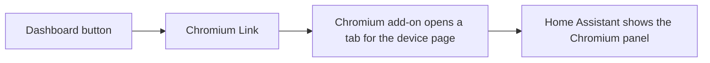

<div align="center">
  
  <h1>Chromium Link</h1>
  <p><strong>Open local device web pages from your Home Assistant dashboard while you’re away.</strong></p>
  <p>
    <a href="#what-you-need"></a>
    <a href="https://github.com/thomasgregg/chromium-link/actions/workflows/validate.yml"></a>
    <a href="LICENSE"></a>
  </p>
</div>

You can reach your Home Assistant dashboard remotely. When you tap a regular dashboard link to `http://wled.local/`, your phone or laptop tries to connect directly to the device. The page won’t load if your phone or laptop can’t reach your local network.

Chromium Link opens the device page in [Chromium](https://github.com/Mincka/ha-addons/tree/main/chromium) running on your Home Assistant host and shows it through the remote connection you already use. Each shortcut is a standard dashboard button with the device’s usual URL. You can skip the VPN client and keep device web interfaces on your local network.

## Contents

- [Why Chromium Link](#why-chromium-link)
- [What you need](#what-you-need)
- [Installation](#installation)
  - [Configure the Chromium add-on](#1-configure-the-chromium-add-on)
  - [Install Chromium Link](#2-install-chromium-link)
- [Add your first button](#add-your-first-button)
- [How it works](#how-it-works)
- [Troubleshooting](#troubleshooting)
- [Security and support](#security-and-support)

## Why Chromium Link

| Approach | When it fits | What it takes |
| --- | --- | --- |
| **Chromium Link** | Open a device web page in one tap from your dashboard. | Set up the Chromium add-on and add a button for each device you want to open. |
| **VPN with access to your local network** | Open devices directly in your own browser, or use other services such as SSH and file sharing. | Set up a VPN gateway or subnet router and connect each phone or computer that needs access. [Tailscale subnet routing example](https://tailscale.com/docs/use-cases/personal-or-at-home-use/access-devices-without-tailscale) |
| **Reverse proxy** | Give a service its own remote web address. | Configure the proxy for each service you want to publish and manage who can reach it. [Caddy reverse proxy example](https://caddyserver.com/docs/quick-starts/reverse-proxy) |
| **Chromium add-on on its own** | Open the occasional page from Chromium’s address bar or bookmarks. | Open Chromium in Home Assistant and choose or enter the device address. |

## What you need

- Home Assistant OS with **Home Assistant 2026.11 or later** and an administrator account.
- **Mincka Chromium 1.7.0 or later**, installed and running on your Home Assistant host. To add it, open **Settings → Apps → Install app → ⋮ → Repositories** and add `https://github.com/mincka/ha-addons`, then install **Chromium**. [Mincka Chromium add-on](https://github.com/Mincka/ha-addons/tree/main/chromium)
- For use away from home, remote access to your Home Assistant dashboard, such as **Home Assistant Link** from Nabu Casa. The setting is called **Home Assistant Cloud** through Home Assistant 2026.11. [Home Assistant remote access guide](https://www.home-assistant.io/docs/configuration/remote/)

<a name="install"></a>

## Installation

### 1. Configure the Chromium add-on

Open **Settings → Apps → Chromium → Configuration**. Set `CHROMIUM_REMOTE_DEBUGGING` to `"1"` and save. In **Network**, leave the `9222/tcp` host port blank. Restart Chromium. In its **Info** tab, enable **Show in sidebar** and **Start on boot**.

Before continuing, open **Chromium** from the sidebar and enter one of your device URLs in its address bar. This confirms that the add-on can reach your device.

### 2. Install Chromium Link

<!-- ha-marketplace:exclude-start -->

[](https://my.home-assistant.io/redirect/marketplace_repository/?owner=thomasgregg&repository=chromium-link&category=integration)

The button opens Chromium Link in the Marketplace as a custom repository. You can also open **Settings → Marketplace → Add from link**, paste `https://github.com/thomasgregg/chromium-link`, and select **Add**. Connect GitHub if prompted. Then open **Chromium Link** in the Marketplace and select **Install**.

<!-- ha-marketplace:exclude-end -->

Follow the setup prompt, or open **Settings → Devices & services → Add integration → Chromium Link**. The setup has no fields. Follow any restart prompt shown by Home Assistant.

<details>
<summary>Manual installation</summary>

1. Download a tagged [release](https://github.com/thomasgregg/chromium-link/releases), or choose **Code → Download ZIP** to download the current source.
2. Copy the `custom_components/chromium_link` folder into the `custom_components` folder beside your Home Assistant `configuration.yaml`.
3. Restart Home Assistant. Open **Settings → Devices & services → Add integration → Chromium Link**.

</details>

## Add your first button

Edit a dashboard and add a standard **Button** card. Choose **Navigate** as the tap action and enter the `navigation_path` shown below. Or open **Show code editor** on the card and paste the full YAML. Replace `http://esp-sensor.local/` with your device’s address.

```yaml
type: button
name: Open ESPHome sensor via HA
icon: mdi:open-in-new
tap_action:
  action: navigate
  navigation_path: "/chromium-launch?url=http://esp-sensor.local/"
```

For more devices, duplicate the button and change its name and address. Paste the full device address after `/chromium-launch?url=` exactly as you copied it from the browser, including any page options or `#` section.

```text
/chromium-launch?url=http://device.local/settings?tab=wifi&mode=advanced#status
```

## How it works



Chromium Link asks the add-on on your Home Assistant host to open the device address in a new tab. Once the add-on confirms the tab is open, Chromium Link switches Home Assistant to the Chromium panel so you can use that page. Home Assistant displays the browser through its existing Ingress connection. Chromium uses its usual shared browser session for its tabs, history, and sign-ins.

## Troubleshooting

- **“Enable CHROMIUM_REMOTE_DEBUGGING in Chromium and restart it.”** Open **Settings → Apps → Chromium → Configuration**, set `CHROMIUM_REMOTE_DEBUGGING` to `1`, and save. Leave the `9222/tcp` host port blank under **Network**. Go to **Info**, restart Chromium, then tap the dashboard button again.
- **“Unable to load custom panel from …/api/chromium_link/panel.js”** Refresh the Home Assistant page in your browser, then try the dashboard button again. If the error persists, check that Chromium Link is listed under **Settings → Devices & services** and follow any pending restart prompt.
- **“Home Assistant could not find the Mincka Chromium app.”** Install **Chromium** from `https://github.com/mincka/ha-addons` under **Settings → Apps**. [Chromium app requirements](#what-you-need)
- **“Start Chromium in Settings → Apps, then try again.”** Select **Start** on the Chromium app’s **Info** tab. Open Chromium from the sidebar to confirm it’s ready, then retry the button.
- **“Chromium did not confirm that it opened the tab.”** Check that debugging is enabled. If you changed `CHROMIUM_REMOTE_DEBUGGING_PORT`, try its default of `9222`. Keep the host port blank under **Network**. Save any changes and restart Chromium.
- **“Open Chromium Link from a Home Assistant dashboard button.”** Tap the dashboard card with the **Navigate** action. If you’re typing into Chromium’s address bar, use the device address itself, such as `http://esp-sensor.local/`. [Button card example](#add-your-first-button)
- **Chromium opens and shows “This site can’t be reached.”** Try the device’s local IP address in Chromium’s address bar. For example, if `http://esp-sensor.local/` fails to resolve and your sensor’s IP is `192.168.1.50`, try `http://192.168.1.50/`. Put the address that works in your dashboard button.

## Security and support

Launching is restricted to Home Assistant administrators. Chromium’s DevTools connection can control the whole browser session. The add-on makes it reachable to other apps on HA’s internal network, even when the host port is unpublished. Use a trusted add-on environment and keep the host port unmapped. Keep credentials out of device URLs.

For problems, [open a GitHub issue](https://github.com/thomasgregg/chromium-link/issues/new/choose) with your Home Assistant and Chromium versions and the error shown. [Report security issues privately](SECURITY.md). See the [changelog](CHANGELOG.md), [contribution guide](CONTRIBUTING.md), and [Marketplace release checklist](docs/marketplace.md).

Chromium Link is an independent community integration released under the [MIT License](LICENSE).
